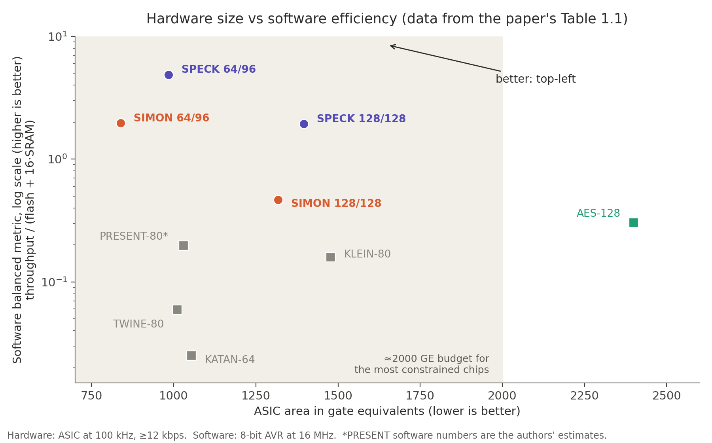
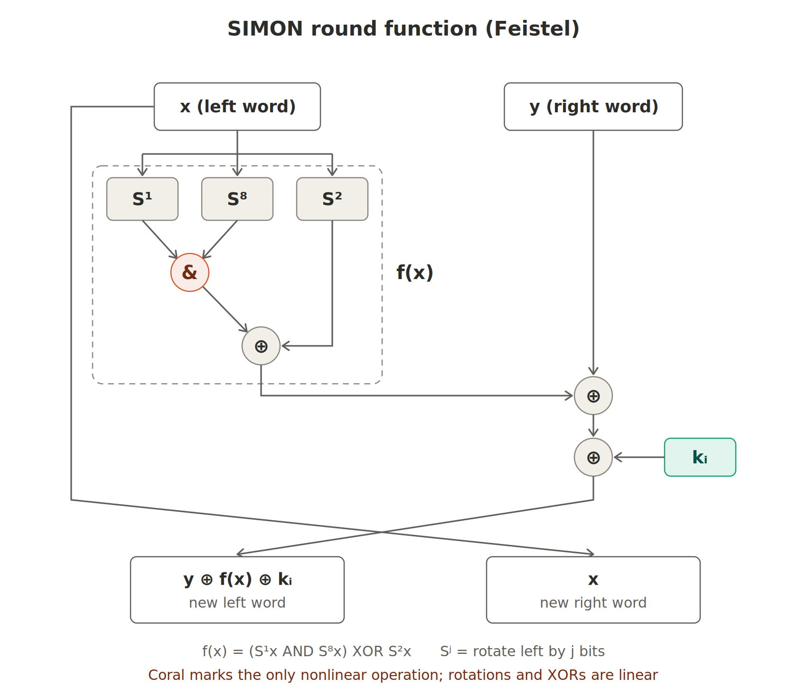
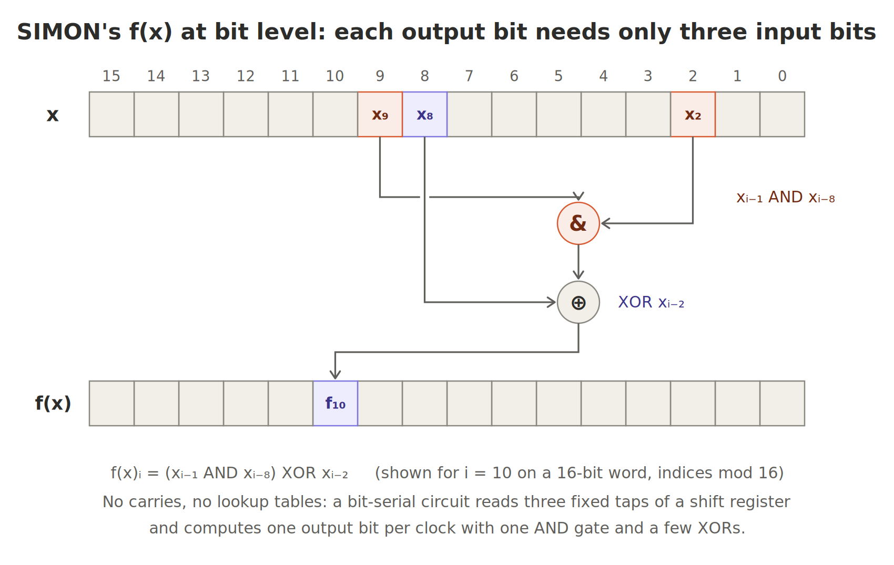
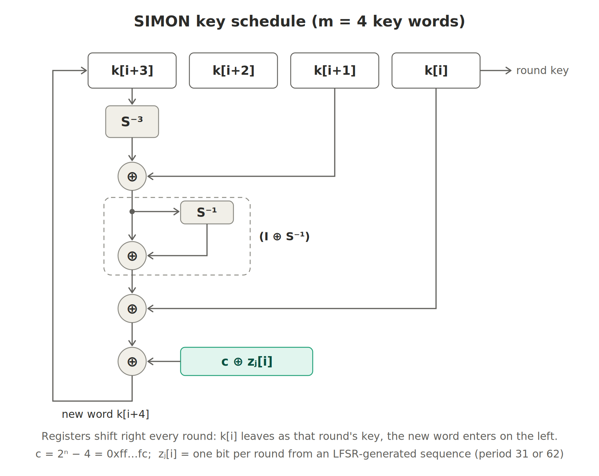
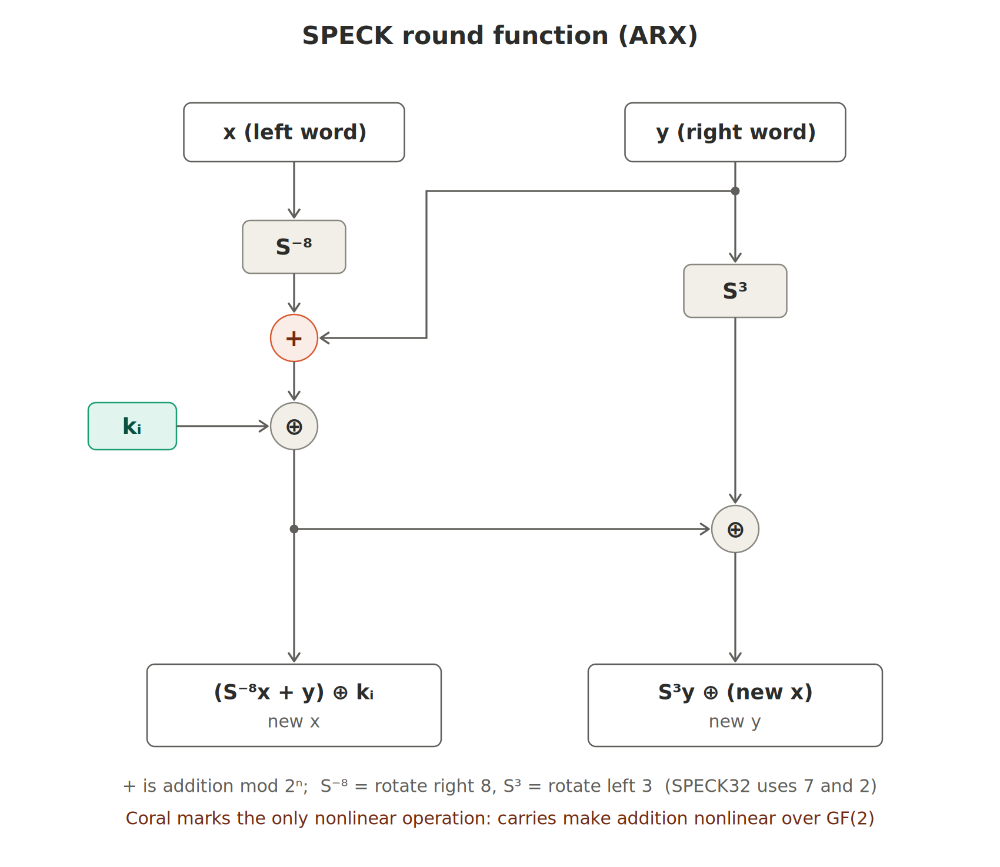
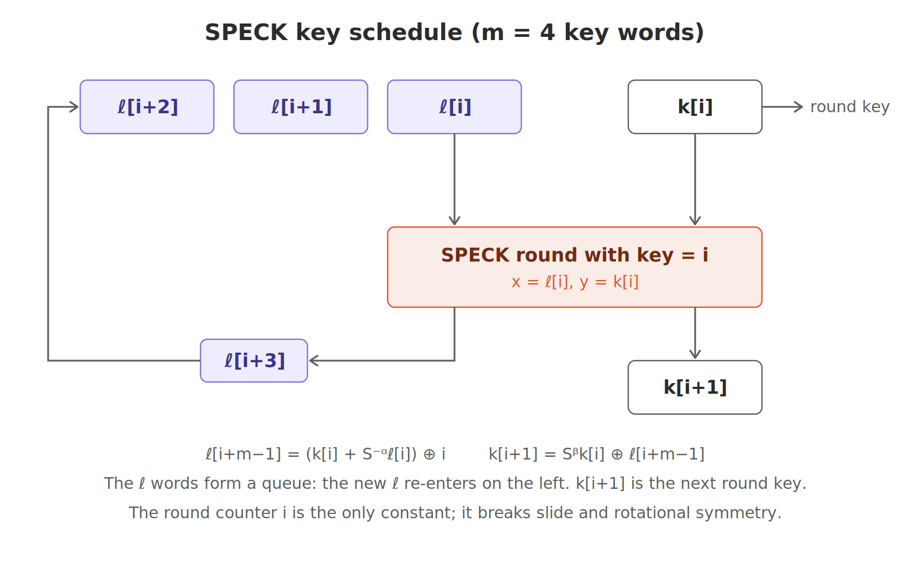
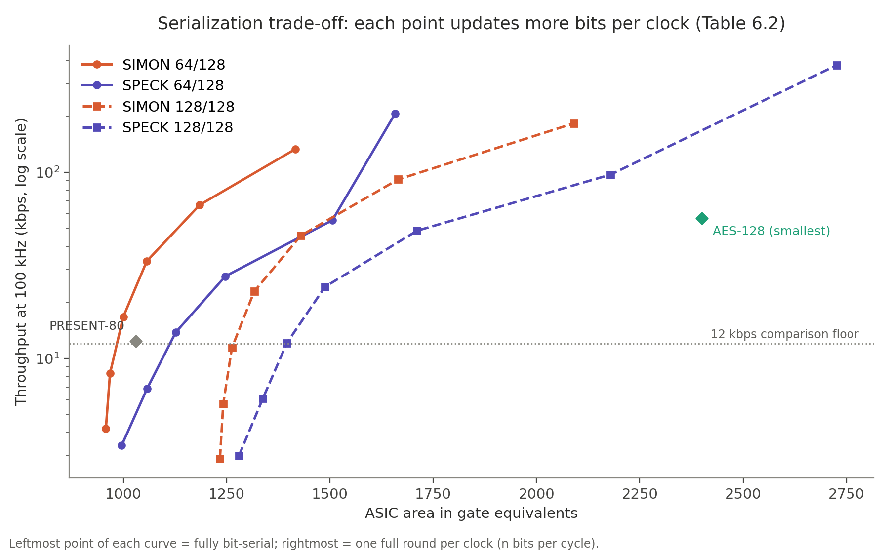
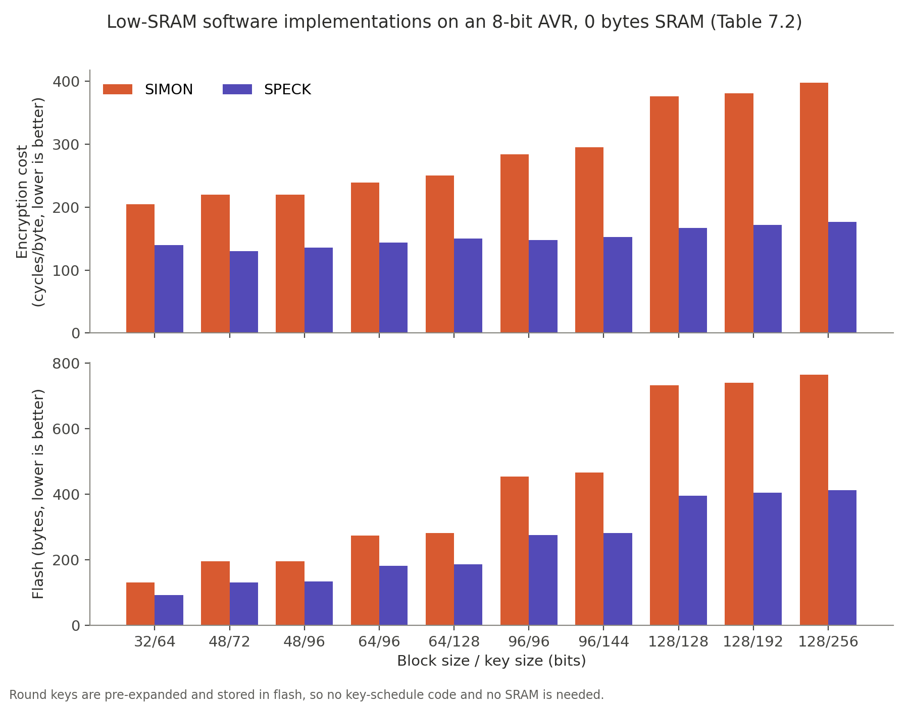

# SIMON and SPECK: Lightweight Block Ciphers (NSA, 2013)

> [!abstract] TL;DR
> SIMON and SPECK are two families of block ciphers, ten variants each, with block sizes from 32 to 128 bits and keys from 64 to 256 bits. Both were designed to be tiny on custom chips (ASICs) *and* on small microcontrollers.
> - **SIMON** is a Feistel cipher whose only nonlinear operation is bitwise AND. It is tuned for hardware.
> - **SPECK** is an ARX cipher (add, rotate, XOR) whose only nonlinear operation is addition mod $2^n$. It is tuned for software.
>
> Both beat the earlier lightweight ciphers on chip area for a given throughput and on code and memory size in software. The paper contains no security analysis, and that shaped how the cryptographic community received it.

> [!info] About the images
> Extract `images.zip` next to this file so the `images/` folder sits beside the `.md`. All diagrams were redrawn for this note. All charts are plotted from the numbers in the paper's tables.

---

## 1. The problem in one paragraph

Billions of tiny devices (RFID tags, sensors, medical implants, car electronics) need encryption, but they have almost no silicon, memory or battery to spare. AES is excellent on PCs and phones but too big for the smallest chips. Many "lightweight" ciphers already existed, but each was tuned for **one** kind of device, either tiny custom chips or tiny microcontrollers, and paid for that on the other. The paper's goal is a single design that is close to the best on both platforms, comes in many block and key sizes, and is simple enough that cryptographers can analyze it.

---

## 2. Foundations

### 2.1 What a block cipher is

A block cipher takes a fixed-size block and a key and outputs a scrambled block of the same size:

$$E_K : \{0,1\}^{2n} \to \{0,1\}^{2n}$$

For each key, $E_K$ is a **permutation**: a reversible shuffle of all $2^{2n}$ possible blocks. The security goal is that, without the key, this shuffle is indistinguishable from a random permutation. Sizes are written as *block/key*, so "64/128" means 64-bit blocks with a 128-bit key.

### 2.2 Rounds and key schedules

Nobody designs one giant scrambling function. Instead you design a small, weak **round function** $R$ and apply it $T$ times. Each round uses a different **round key**, and the round keys are derived from the master key by the **key schedule**:

$$E_K = R_{k_{T-1}} \circ \cdots \circ R_{k_1} \circ R_{k_0}$$

Every design choice comes down to two questions: how cheap can one round be, and how many rounds do you need?

### 2.3 Confusion and diffusion (Shannon)

A round has two jobs.

- **Nonlinearity (confusion).** XOR and bit rotations are linear over $GF(2)$. If every operation were linear, the whole cipher would collapse into a matrix multiplication plus a constant, and a few plaintext–ciphertext pairs would let you solve for the key with Gaussian elimination. So you need at least one nonlinear operation. AES uses an S-box (a lookup table), SIMON uses **AND**, and SPECK uses **addition mod $2^n$**.
- **Diffusion.** After a few rounds, every output bit should depend on every input bit and every key bit. Rotations and XORs spread bits around to do this.

### 2.4 Feistel networks

Split the block into two halves $(x, y)$. One round is:

$$R_k(x, y) = \big(y \oplus F(x) \oplus k,\; x\big)$$

This is invertible **whatever $F$ is**. Given the output $(a, b)$, you recover $x = b$ and then $y = a \oplus F(b) \oplus k$. So $F$ itself never has to be invertible, which is what lets SIMON use AND, a non-invertible operation, as its only nonlinear piece. DES uses the same structure.

### 2.5 ARX: Add, Rotate, XOR

Addition mod $2^n$ is nonlinear over $GF(2)$ because of carries:

$$(x + y)_i = x_i \oplus y_i \oplus c_i, \qquad c_0 = 0,\quad c_{i+1} = \mathrm{maj}(x_i, y_i, c_i)$$

The majority function is built from ANDs and ORs. Bit $i$ of a sum therefore depends nonlinearly on **every lower bit**. One addition gives you a whole chain of ANDs, and on a CPU it costs a single instruction.

### 2.6 How "small" is measured in hardware

- **Gate equivalents (GE).** 1 GE is the area of a 2-input NAND gate. In the paper's cell library (IBM 8RF, 130 nm):

| Cell | Area (GE) | Cell | Area (GE) |
|---|---|---|---|
| NOT | 0.75 | XOR / XNOR | 2.00 |
| NAND | 1.00 | 2-to-1 MUX | 2.25 |
| AND / OR | 1.25 | D flip-flop | 4.25 |
| 1-bit full adder | 5.75 | Scan flip-flop | 6.25 |

- **Storage dominates.** Every bit of state and key needs a flip-flop. A 64-bit block plus a 96-bit key is 160 flip-flops, about 680 GE before any logic at all. The accepted budget for the most constrained devices was about **2000 GE**.
- **Throughput** is quoted at a **100 kHz** clock, which is typical for RFID.
- **Serialization.** An *iterated* circuit computes a whole round per clock: fast, but needs a lot of logic. A *bit-serial* circuit updates one bit per clock: slow, but needs logic for only one bit. A flexible cipher lets you choose any point in between to match your area budget.

### 2.7 How "small" is measured in software

The target platform is an 8-bit microcontroller. The paper's example is the Atmel ATtiny45, which has 4 KB of flash and 256 bytes of SRAM. The costs that matter are flash (code), SRAM (RAM) and cycles per byte. The paper combines them into a **balanced performance metric**:

$$\text{balanced} = \frac{\text{throughput}}{\text{flash} + 16 \cdot \text{SRAM}}$$

The factor 16 is there because the ATtiny45 has 16× more flash than SRAM, so each byte of RAM counts 16 times as much.

---

## 3. The problem in detail

Pervasive computing means huge numbers of constrained devices talking wirelessly. The paper's examples are that nobody should be able to take over your insulin pump or your car's brakes.

Two points from the paper's framing are worth keeping in mind:

- A block cipher **does not provide security by itself**; you still need protocols on top. But it is the most versatile primitive to build those protocols from (encryption modes, MACs and so on).
- *"Why not just use AES?"* The paper's answer is to use AES wherever it fits. But the smallest AES circuit at the time needed about **2400 GE**, above the roughly 2000 GE budget. AES also comes only with a 128-bit block, while many lightweight uses are fine with 64 bits.

---

## 4. Why the existing lightweight ciphers fell short

The central observation: **design choices that make a cipher great on one platform tend to hurt it on another.**

| Design choice | Example | Good on | Bad on, because… |
|---|---|---|---|
| 8-bit S-boxes | AES | Software (table lookup) | Hardware. You can't serialize below the S-box width, so even the smallest AES circuit processes a byte per clock: 56.6 kbps at 2400 GE. That is faster than needed, and the extra speed can't be traded for area. |
| Bit permutations | PRESENT | Hardware (moving a bit is just a wire, 0 GE) | Software. An 8-bit CPU has to extract and reinsert bits one at a time: about 96 kbps vs 888 kbps for SPECK64/96. |
| Bit-serial NLFSR-like state | KATAN | Hardware (tiny) | Software has to emulate it bit by bit (14 kbps). Speeding up the hardware means duplicating logic, which is costly. |
| Hardwired key | KTANTAN, PRINTcipher | Area (no key flip-flops) | Flexibility. The key can never be changed. |
| Software-leaning designs | TWINE, KLEIN | Software | Larger in hardware. TWINE's balanced implementation needs 414 bytes of SRAM, more than an ATtiny45 has. |
| Few sizes | most designs | – | Electronic product code (EPC) tags want 48- or 96-bit blocks, and key needs range from 64 to 256 bits. |



*Every earlier design is either far to the right (a big chip) or near the bottom (poor software). SIMON and SPECK sit alone in the top-left. The ratios match the paper's claim that SIMON64/96 and SPECK64/96 have about 10× and 25× better balanced performance than PRESENT-80.*

---

## 5. The design strategy

| Failure mode | SIMON / SPECK response |
|---|---|
| Expensive operations on some platform | Use only XOR, AND, rotations and (in SPECK) modular addition. Rotations are free wiring in hardware, and on an 8-bit CPU a rotation by 8 is just relabeling which register holds which byte, which is likely one reason 8 appears in both designs. |
| Rounds that are big or complex | A **tiny round, many rounds**. Throughput is rarely the bottleneck in lightweight use. |
| S-boxes and bit permutations block serialization | Neither design uses them, so both can be **serialized at any width**, from 1 bit per clock up to a full round. |
| One size for everything | **Families**: block sizes 32, 48, 64, 96 and 128 bits, with one to three key sizes each, giving 10 variants per family. |
| Designs that are hard to analyze | **Simple structure** that invites cryptanalysis. |

**Supported sizes (Table 2.1):**

| Block size | Key sizes |
|---|---|
| 32 | 64 |
| 48 | 72, 96 |
| 64 | 96, 128 |
| 96 | 96, 144 |
| 128 | 128, 192, 256 |

**Security stance.** The margin is deliberately **tight, not lavish**. The target adversary is the standard one, who can adaptively encrypt and decrypt large amounts of data. The designers also aim to resist **related-key** attacks, where the attacker can flip key bits. They make no claims for the open-key model, and the ciphers are not evaluated for use as hash functions. The paper also asks openly what adversary model even makes sense for devices that encrypt very little data during their whole lifetime.

---

## 6. SIMON: the hardware-tuned cipher

### 6.1 Notation

- Word size $n \in \{16, 24, 32, 48, 64\}$, block size $2n$, key size $mn$ with $m \in \{2, 3, 4\}$ words, $T$ rounds.
- $S^j$ means rotate left by $j$ bits ($x \lll j$), and $S^{-j}$ means rotate right.
- SIMON$2n$/$mn$ names a variant; for example, SIMON64/128 has $n = 32$ and $m = 4$.

### 6.2 Round function

$$R_k(x, y) = \big(y \oplus f(x) \oplus k,\; x\big), \qquad f(x) = (S^1x \,\&\, S^8x) \oplus S^2x$$

$$R_k^{-1}(x, y) = \big(y,\; x \oplus f(y) \oplus k\big)$$



### 6.3 Why $f$ is so hardware-friendly

Bit $i$ of $S^j x$ is bit $i-j$ of $x$, so each output bit of $f$ is:

$$f(x)_i = (x_{i-1} \wedge x_{i-8}) \oplus x_{i-2} \qquad (\text{indices mod } n)$$

Each output bit depends on just **three input bits at fixed offsets**. There are no carries and no lookup tables.



In a bit-serial circuit, the words sit in shift registers and the three rotations are just taps at different positions. Each clock needs one AND and a few XORs. As a result:

- Fully serial **SIMON32/64 fits in 523 GE** (Table 6.1).
- **Doubling the throughput costs about 9 GE**, and quadrupling it about 33 GE: you just copy the one-bit slice.

### 6.4 Other design details

- **Why AND is enough.** AND is the cheapest nonlinear gate, but it only creates degree-2 terms, so each round adds only a little nonlinearity. SIMON compensates with many rounds: **32 to 72**. The rotation amounts 1 and 8 make the AND combine bits that are far apart, and the $S^2$ term adds linear spreading.
- **No whitening.** SIMON does not XOR key into the plaintext before the first round or into the ciphertext after the last, because that would cost circuit area. As a consequence, the first and last rounds do little more than mix in key.
- **Decryption is almost free.** A Feistel inverse uses the same $f$; you swap the halves and run the round keys in reverse order.

### 6.5 Parameters (Table 3.1)

| Block $2n$ | Key $mn$ | $n$ | $m$ | Constant | Rounds $T$ |
|---|---|---|---|---|---|
| 32 | 64 | 16 | 4 | $z_0$ | 32 |
| 48 | 72 | 24 | 3 | $z_0$ | 36 |
| 48 | 96 | 24 | 4 | $z_1$ | 36 |
| 64 | 96 | 32 | 3 | $z_2$ | 42 |
| 64 | 128 | 32 | 4 | $z_3$ | 44 |
| 96 | 96 | 48 | 2 | $z_2$ | 52 |
| 96 | 144 | 48 | 3 | $z_3$ | 54 |
| 128 | 128 | 64 | 2 | $z_2$ | 68 |
| 128 | 192 | 64 | 3 | $z_3$ | 69 |
| 128 | 256 | 64 | 4 | $z_4$ | 72 |

### 6.6 Key schedule

The $m$ key words are used directly as the first $m$ round keys. Every later round key is a **linear** function of earlier ones:

$$
k_{i+m} =
\begin{cases}
c \oplus (z_j)_i \oplus k_i \oplus (I \oplus S^{-1})\, S^{-3} k_{i+1} & m = 2 \\
c \oplus (z_j)_i \oplus k_i \oplus (I \oplus S^{-1})\, S^{-3} k_{i+2} & m = 3 \\
c \oplus (z_j)_i \oplus k_i \oplus (I \oplus S^{-1})\big(S^{-3} k_{i+3} \oplus k_{i+1}\big) & m = 4
\end{cases}
$$

- $(I \oplus S^{-1})\,v$ means $v \oplus (v \ggg 1)$.
- $c = 2^n - 4 = \texttt{0xff\ldots fc}$. The pseudocode writes this as `~k ^ 3`, which is the same thing.
- $(z_j)_i$ is one constant bit per round. The sequences $u, v, w$ come from 5-bit LFSRs with period 31. $z_0 = u$ and $z_1 = v$; $z_2, z_3, z_4$ are $u, v, w$ XORed with $0101\ldots$, which gives period 62.



> [!important] Why the round constants exist
> Every SIMON round is identical apart from its key, and that creates two weaknesses the constants are there to remove.
> 1. **Slide attacks.** If the round keys repeated, encryption would be one function $F$ applied $T$ times. An attacker who finds a pair with $P' = F(P)$ automatically gets $C' = F(C)$, and the number of rounds stops mattering. The constants make every round slightly different.
> 2. **Rotational symmetry.** $f$ commutes with rotation: $f(Sx) = S\,f(x)$. If the key schedule had the same property, rotating both the plaintext and the key by one bit would simply rotate the ciphertext, which is an easy distinguisher. The constant $c \oplus (z_j)_i$ is not rotation-invariant, so this fails.
>
> Using a different $z$ sequence for each variant also keeps variants with the same block size (for example SIMON64/96 and SIMON64/128) cryptographically separate.

### 6.7 Pseudocode

```text
# key expansion: k[0..m-1] are the key words
for i = m .. T-1:
    tmp  = k[i-1] >>> 3
    if m == 4: tmp ^= k[i-3]
    tmp ^= tmp >>> 1
    k[i] = ~k[i-m] ^ tmp ^ z_j[(i-m) mod 62] ^ 3

# encryption
for i = 0 .. T-1:
    x, y = y ^ ((x <<< 1) & (x <<< 8)) ^ (x <<< 2) ^ k[i],  x
```

### 6.8 Worked example: SIMON32/64 (Appendix B test vector)

Key words $(k_3, k_2, k_1, k_0) = (\texttt{1918}, \texttt{1110}, \texttt{0908}, \texttt{0100})$, plaintext $(x, y) = (\texttt{6565}, \texttt{6877})$, $n = 16$, $T = 32$.

| Round | $x$ | $y$ | $k_i$ | $S^1x$ | $S^8x$ | AND | $S^2x$ | $f(x)$ | new $x$ | new $y$ |
|---|---|---|---|---|---|---|---|---|---|---|
| 0 | 6565 | 6877 | 0100 | caca | 6565 | 4040 | 9595 | d5d5 | bca2 | 6565 |
| 1 | bca2 | 6565 | 0908 | 7945 | a2bc | 2004 | f28a | d28e | bee3 | bca2 |

On a 16-bit word, $S^8$ just swaps the two bytes, so $S^8(\texttt{6565}) = \texttt{6565}$. After all 32 rounds the ciphertext is **`c69b e9bb`**, matching the paper. The first generated round keys are `71c3`, `b649`, and so on.

---

## 7. SPECK: the software-tuned cipher

### 7.1 Round function

$$R_k(x, y) = \big((S^{-\alpha}x + y) \oplus k,\;\; S^{\beta}y \oplus (S^{-\alpha}x + y) \oplus k\big)$$

or, written as two update steps:

$$x \leftarrow (S^{-\alpha}x + y) \oplus k, \qquad y \leftarrow S^{\beta}y \oplus x$$

The rotation amounts are $(\alpha, \beta) = (8, 3)$, except for SPECK32, which uses $(7, 2)$. The `+` is addition mod $2^n$.



### 7.2 Design details

- **Fewer rounds.** In a sum, bit $i$ depends on every lower bit through the carry chain, so one addition creates far more nonlinearity than one AND. SPECK needs only **22 to 34 rounds**; for 128/128 that is 32 rounds against SIMON's 68.
- **Structure.** A SPECK round is the composition of two Feistel-like steps, one over addition mod $2^n$ and one over XOR (Figure 4.2 in the paper):
$$(x, y) \mapsto \big(y,\ (S^{-\alpha}x + y) \oplus k\big) \quad\text{and}\quad (x, y) \mapsto \big(y,\ S^{\beta}x \oplus y\big)$$
- **Ancestry.** The round is related to the MIX function of the Threefish cipher inside the Skein hash. SPECK is simpler: it uses fixed rotation amounts, adds key by XOR, and has no word permutations.
- **Decryption** runs the round backwards, using modular subtraction and the opposite rotations:
$$R_k^{-1}(x, y) = \Big(S^{\alpha}\big((x \oplus k) - S^{-\beta}(x \oplus y)\big),\ S^{-\beta}(x \oplus y)\Big)$$

### 7.3 Parameters (Table 4.1)

| Block $2n$ | Key $mn$ | $n$ | $m$ | $\alpha$ | $\beta$ | Rounds $T$ |
|---|---|---|---|---|---|---|
| 32 | 64 | 16 | 4 | 7 | 2 | 22 |
| 48 | 72 | 24 | 3 | 8 | 3 | 22 |
| 48 | 96 | 24 | 4 | 8 | 3 | 23 |
| 64 | 96 | 32 | 3 | 8 | 3 | 26 |
| 64 | 128 | 32 | 4 | 8 | 3 | 27 |
| 96 | 96 | 48 | 2 | 8 | 3 | 28 |
| 96 | 144 | 48 | 3 | 8 | 3 | 29 |
| 128 | 128 | 64 | 2 | 8 | 3 | 32 |
| 128 | 192 | 64 | 3 | 8 | 3 | 33 |
| 128 | 256 | 64 | 4 | 8 | 3 | 34 |

### 7.4 Key schedule: reusing the round function

Write the key as $K = (\ell_{m-2}, \ldots, \ell_0, k_0)$. Then:

$$\ell_{i+m-1} = (k_i + S^{-\alpha}\ell_i) \oplus i, \qquad k_{i+1} = S^{\beta}k_i \oplus \ell_{i+m-1}$$

This is exactly the SPECK round applied to the pair $(\ell_i, k_i)$, with the **round counter $i$ playing the role of the round key**.



Reusing the round means no separate key-schedule circuit and almost no extra code. The counter $i$ does the job SIMON's $c$ and $z$ constants do: it breaks slide and rotational symmetry. It also makes generating round keys on the fly trivial. Appendix A of the paper shows a five-line C routine that encrypts SPECK128/128 at **9.3 cycles/byte** on a 64-bit CPU while generating the round keys as it goes.

### 7.5 Pseudocode

```text
# key expansion: key = (l[m-2], ..., l[0], k[0])
for i = 0 .. T-2:
    l[i+m-1] = (k[i] + (l[i] >>> α)) ^ i
    k[i+1]   = (k[i] <<< β) ^ l[i+m-1]

# encryption
for i = 0 .. T-1:
    x = ((x >>> α) + y) ^ k[i]
    y = (y <<< β) ^ x
```

### 7.6 Worked example: SPECK32/64 (Appendix C test vector)

Key $(\ell_2, \ell_1, \ell_0, k_0) = (\texttt{1918}, \texttt{1110}, \texttt{0908}, \texttt{0100})$, plaintext $(x, y) = (\texttt{6574}, \texttt{694c})$, $\alpha = 7$, $\beta = 2$, $T = 22$.

| Round | $x$ | $y$ | $k_i$ | $S^{-7}x$ | $+\,y \bmod 2^{16}$ | new $x$ ($\oplus k_i$) | $S^2y$ | new $y$ |
|---|---|---|---|---|---|---|---|---|
| 0 | 6574 | 694c | 0100 | e8ca | 5216 | 5316 | a531 | f627 |
| 1 | 5316 | f627 | 1512 | 2ca6 | 22cd | 37df | d89f | ef40 |

In round 0, `e8ca + 694c = 1_5216`; the carry out of bit 15 is dropped because addition is mod $2^{16}$. After all 22 rounds the ciphertext is **`a868 42f2`**, matching the paper.

---

## 8. Why SIMON suits hardware and SPECK suits software

The deciding factor is the nonlinear operation.

| | SIMON (AND) | SPECK (modular addition) |
|---|---|---|
| Hardware cost per serial bit | 1 AND (1.25 GE) | Full adder (5.75 GE) plus a carry flip-flop |
| Extra area to double / quadruple throughput | about 9 / 33 GE | about 59 / 126 GE |
| Nonlinearity per round | Weak (degree 2, bit-local) | Strong (carry chain) |
| Rounds for 128/128 | 68 | 32 |
| 8-bit AVR rotations | 1, 2 cost shift instructions; 8 is free | 3 costs shifts; 8 is free |
| 8-bit AVR, 128/128 low-SRAM | 376 cycles/byte, 732 B flash | 167 cycles/byte, 396 B flash |
| Decryption cost | Nearly free (Feistel) | Needs subtraction and inverse rotations |

On an 8-bit CPU, a 64-bit addition is one `add` plus seven `adc` (add-with-carry) instructions, about the same cost as an AND. Because SPECK needs half as many rounds, it ends up about twice as fast in software. Both ciphers are still good on their "other" platform, which is the whole point of the paper: neither one gives up a platform the way PRESENT or KATAN did.

---

## 9. Results

### 9.1 Head-to-head comparison (Table 1.1)

Hardware: minimal-area ASIC achieving at least 12 kbps at 100 kHz. Software: balanced implementation on an 8-bit AVR at 16 MHz. Numbers in brackets are the authors' estimates; "–" means no data was available.

| Size | Cipher | Area (GE) | HW kbps | Flash (B) | SRAM (B) | SW kbps |
|---|---|---|---|---|---|---|
| 48/96 | **SIMON** | 763 | 15.0 | 196 | 0 | 589 |
| | **SPECK** | 884 | 12.0 | 134 | 0 | 943 |
| | EPCBC | 1008 | 12.1 | [365] | 0 | [93] |
| 64/80 | TWINE | 1011 | 16.2 | 1304 | 414 | 472 |
| | PRESENT | 1030 | 12.4 | [487] | 0 | 96 |
| | Piccolo | 1043 | 14.8 | – | – | – |
| | KATAN | 1054 | 25.1 | 272 | 18 | 14 |
| | KLEIN | 1478 | 23.6 | 766 | 18 | 168 |
| 64/96 | **SIMON** | 838 | 17.8 | 274 | 0 | 540 |
| | **SPECK** | 984 | 14.5 | 182 | 0 | 888 |
| | KLEIN | 1528 | 19.1 | [766] | [18] | [134] |
| 64/128 | **SIMON** | 1000 | 16.7 | 282 | 0 | 515 |
| | **SPECK** | 1127 | 13.8 | 186 | 0 | 855 |
| | Piccolo | 1334 | 12.1 | – | – | – |
| | PRESENT | 1339 | 12.1 | [487] | [0] | [96] |
| 96/96 | **SIMON** | 984 | 14.8 | 454 | 0 | 454 |
| | **SPECK** | 1134 | 13.8 | 276 | 0 | 866 |
| | EPCBC | 1333 | 12.1 | [730] | 0 | [93] |
| 128/128 | **SIMON** | 1317 | 22.9 | 732 | 0 | 342 |
| | **SPECK** | 1396 | 12.1 | 396 | 0 | 768 |
| | AES | 2400 | 56.6 | 943 | 33 | 445 |

There is no 80-bit-key variant of SIMON or SPECK, so the paper groups the 64/80 ciphers next to its own 64/96 versions.

### 9.2 Hardware flexibility



- Fully serial (smallest) versions range from **523 GE** (SIMON32/64) to **1840 GE** (SPECK128/256) (Table 6.1).
- SIMON64/128 spans **958 GE at 4.2 kbps** up to **1417 GE at 133 kbps** (Table 6.2).
- SIMON128/128 and SPECK128/128 fit in roughly **half of AES's area**.

### 9.3 Software on 8-bit microcontrollers



- The best balanced implementations use **0 bytes of SRAM**: round keys are pre-expanded and stored in flash.
- **High-throughput** (Table 7.1): SPECK128/128 runs at 139 cycles/byte with 388 B flash and 256 B SRAM. The fastest AES-128 at the time ran at 125 cycles/byte but needed 1912 B flash and 432 B SRAM.
- SPECK64/128 can encrypt at 120 cycles/byte using less than a sixth of that AES's flash (284 B) and a quarter of its SRAM (108 B).
- Generating the round keys costs about as many cycles as encrypting one block.

### 9.4 64-bit processors (Appendix A)

These matter for the server side, for example an RFID reader talking to thousands of tags.

| Cipher | Reference C (cycles/byte) | SSE (cycles/byte) |
|---|---|---|
| SIMON128/128 | 21.6 | 7.5 |
| SPECK128/128 | 5.7 | 2.6 |
| TEA (for comparison) | 51.7 | – |

---

## 10. Reading the paper critically

> [!warning] Caveats the paper admits or implies
> - **Different cell libraries.** The authors' D flip-flop is smaller than some other authors' (4.25 vs 4.67 GE), which flatters their areas somewhat, though they argue it doesn't explain the whole advantage.
> - **Decryption excluded.** Their hardware areas and software code sizes are encrypt-only, and they subtracted decryption code from competitors' published figures, estimating the amount where code wasn't available.
> - **Pre-expanded keys.** Their best software numbers store round keys in flash, so no key-schedule code is counted. Some competitors' numbers include a key schedule.
> - **Estimates.** Some competitor figures (in brackets) are the authors' own estimates.
> - **Synthesis only.** The hardware was never fabricated, so there are no power measurements.
> - **No security analysis.** There are no differential or linear bounds, and no justification for the rotation amounts, the constants, or the round counts. The authors say only that the margin is sufficient but tight. Coming from the NSA, this "trust us" stance shaped everything that followed.

---

## 11. What happened after publication

- Academic cryptanalysis has broken a large fraction of the rounds in reduced-round versions, but **no attack breaks the full ciphers**.
- The NSA published **design notes in 2017** after criticism over the missing rationale.
- **ISO declined to standardize** SIMON and SPECK in 2018, largely over trust concerns.
- SPECK was briefly added to the **Linux kernel** for disk encryption on low-end Android phones, then removed after Google built **Adiantum** instead.
- NIST's lightweight-cryptography competition eventually chose **Ascon** (2023).
- SIMON and SPECK remain standard reference designs for AND-RX and ARX cryptanalysis.

---

## 12. Quick recall

> [!question]- What gap does the paper fill?
> A lightweight block cipher family that is near-best in **both** ASIC hardware and 8-bit software, comes in many block and key sizes, and can be serialized at any width.

> [!question]- Why was AES not enough for the smallest devices?
> Its smallest circuit is about 2400 GE, above the roughly 2000 GE budget. Its 8-bit S-box prevents serializing below a byte, so you can't trade speed for area. And it only offers a 128-bit block.

> [!question]- What is SIMON's only nonlinear operation, and why does that help hardware?
> Bitwise AND. It is the cheapest nonlinear gate (1.25 GE), and since $f(x)_i = (x_{i-1} \wedge x_{i-8}) \oplus x_{i-2}$ depends only on bits at fixed offsets, it can be computed one bit per clock using shift-register taps.

> [!question]- What is SPECK's only nonlinear operation, and why does it need fewer rounds?
> Addition mod $2^n$. The carry chain makes each bit depend nonlinearly on all lower bits, so each round adds much more nonlinearity than an AND, giving 22–34 rounds versus SIMON's 32–72.

> [!question]- Why can SIMON use a non-invertible $f$?
> It is a Feistel network: the round is invertible whatever $f$ is, since $y = a \oplus f(b) \oplus k$ can always be recomputed.

> [!question]- Why does SIMON's key schedule add $c \oplus (z_j)_i$?
> To destroy slide properties (every round would otherwise be identical) and rotational symmetry (since $f(Sx) = S f(x)$). Different $z_j$ sequences also separate variants that share a block size.

> [!question]- What is special about SPECK's key schedule?
> It reuses the SPECK round function, with the round counter $i$ as the "key". The counter breaks the symmetries, and on-the-fly round-key generation becomes trivial.

> [!question]- What is the balanced performance metric?
> $\text{throughput} / (\text{flash} + 16 \cdot \text{SRAM})$. The factor 16 reflects the ATtiny45's flash-to-SRAM ratio (4096 / 256).

> [!question]- What is the biggest weakness of the paper itself?
> It gives no security analysis or design rationale for the constants, rotation amounts or round counts.

---

## Appendix: Reference implementation (Python)

All 10 SIMON and 10 SPECK variants. Checked against every test vector in Appendices B and C, both encryption and decryption. Key words in the paper's test vectors are written most-significant first, so they are reversed before use: `[k0, k1, ...]` for SIMON and `[k0, l0, l1, ...]` for SPECK.

```python
Z = ["11111010001001010110000111001101111101000100101011000011100110",
     "10001110111110010011000010110101000111011111001001100001011010",
     "10101111011100000011010010011000101000010001111110010110110011",
     "11011011101011000110010111100000010010001010011100110100001111",
     "11010001111001101011011000100000010111000011001010010011101111"]

SIMON = {(16, 4): (32, 0), (24, 3): (36, 0), (24, 4): (36, 1), (32, 3): (42, 2), (32, 4): (44, 3),
         (48, 2): (52, 2), (48, 3): (54, 3), (64, 2): (68, 2), (64, 3): (69, 3), (64, 4): (72, 4)}
SPECK = {(16, 4): 22, (24, 3): 22, (24, 4): 23, (32, 3): 26, (32, 4): 27,
         (48, 2): 28, (48, 3): 29, (64, 2): 32, (64, 3): 33, (64, 4): 34}

def rol(v, r, n): return ((v << r) | (v >> (n - r))) & ((1 << n) - 1)
def ror(v, r, n): return ((v >> r) | (v << (n - r))) & ((1 << n) - 1)

def simon_round_keys(key, n):
    """key = [k0, k1, ..., k_{m-1}]  (k0 is the RIGHTMOST word in the paper's test vectors)"""
    m = len(key); T, j = SIMON[(n, m)]; mask = (1 << n) - 1
    k = list(key)
    for i in range(m, T):
        tmp = ror(k[i - 1], 3, n)
        if m == 4:
            tmp ^= k[i - 3]
        tmp ^= ror(tmp, 1, n)
        k.append((~k[i - m] & mask) ^ tmp ^ int(Z[j][(i - m) % 62]) ^ 3)
    return k

def simon_f(v, n): return (rol(v, 1, n) & rol(v, 8, n)) ^ rol(v, 2, n)

def simon_encrypt(x, y, key, n):
    for k in simon_round_keys(key, n):
        x, y = y ^ simon_f(x, n) ^ k, x
    return x, y

def simon_decrypt(x, y, key, n):
    for k in reversed(simon_round_keys(key, n)):
        x, y = y, x ^ simon_f(y, n) ^ k
    return x, y

def speck_round_keys(key, n):
    """key = [k0, l0, l1, ..., l_{m-2}]  (k0 is the RIGHTMOST word in the paper's test vectors)"""
    m = len(key); T = SPECK[(n, m)]; mask = (1 << n) - 1
    a, b = (7, 2) if n == 16 else (8, 3)
    k, l = [key[0]], list(key[1:])
    for i in range(T - 1):
        l.append(((k[i] + ror(l[i], a, n)) & mask) ^ i)
        k.append(rol(k[i], b, n) ^ l[i + m - 1])
    return k

def speck_encrypt(x, y, key, n):
    a, b = (7, 2) if n == 16 else (8, 3); mask = (1 << n) - 1
    for k in speck_round_keys(key, n):
        x = ((ror(x, a, n) + y) & mask) ^ k
        y = rol(y, b, n) ^ x
    return x, y

def speck_decrypt(x, y, key, n):
    a, b = (7, 2) if n == 16 else (8, 3); mask = (1 << n) - 1
    for k in reversed(speck_round_keys(key, n)):
        y = ror(x ^ y, b, n)
        x = rol(((x ^ k) - y) & mask, a, n)
    return x, y

# Test vectors from Appendices B and C: (n, key words left-to-right, plaintext, ciphertext)
VECTORS = {
 "simon": [
  (16, "1918 1110 0908 0100", "6565 6877", "c69b e9bb"),
  (24, "121110 0a0908 020100", "612067 6e696c", "dae5ac 292cac"),
  (24, "1a1918 121110 0a0908 020100", "726963 20646e", "6e06a5 acf156"),
  (32, "13121110 0b0a0908 03020100", "6f722067 6e696c63", "5ca2e27f 111a8fc8"),
  (32, "1b1a1918 13121110 0b0a0908 03020100", "656b696c 20646e75", "44c8fc20 b9dfa07a"),
  (48, "0d0c0b0a0908 050403020100", "2072616c6c69 702065687420", "602807a462b4 69063d8ff082"),
  (48, "151413121110 0d0c0b0a0908 050403020100", "746168742074 73756420666f", "ecad1c6c451e 3f59c5db1ae9"),
  (64, "0f0e0d0c0b0a0908 0706050403020100", "6373656420737265 6c6c657661727420", "49681b1e1e54fe3f 65aa832af84e0bbc"),
  (64, "1716151413121110 0f0e0d0c0b0a0908 0706050403020100", "206572656874206e 6568772065626972", "c4ac61effcdc0d4f 6c9c8d6e2597b85b"),
  (64, "1f1e1d1c1b1a1918 1716151413121110 0f0e0d0c0b0a0908 0706050403020100", "74206e69206d6f6f 6d69732061207369", "8d2b5579afc8a3a0 3bf72a87efe7b868")],
 "speck": [
  (16, "1918 1110 0908 0100", "6574 694c", "a868 42f2"),
  (24, "121110 0a0908 020100", "20796c 6c6172", "c049a5 385adc"),
  (24, "1a1918 121110 0a0908 020100", "6d2073 696874", "735e10 b6445d"),
  (32, "13121110 0b0a0908 03020100", "74614620 736e6165", "9f7952ec 4175946c"),
  (32, "1b1a1918 13121110 0b0a0908 03020100", "3b726574 7475432d", "8c6fa548 454e028b"),
  (48, "0d0c0b0a0908 050403020100", "65776f68202c 656761737520", "9e4d09ab7178 62bdde8f79aa"),
  (48, "151413121110 0d0c0b0a0908 050403020100", "656d6974206e 69202c726576", "2bf31072228a 7ae440252ee6"),
  (64, "0f0e0d0c0b0a0908 0706050403020100", "6c61766975716520 7469206564616d20", "a65d985179783265 7860fedf5c570d18"),
  (64, "1716151413121110 0f0e0d0c0b0a0908 0706050403020100", "7261482066656968 43206f7420746e65", "1be4cf3a13135566 f9bc185de03c1886"),
  (64, "1f1e1d1c1b1a1918 1716151413121110 0f0e0d0c0b0a0908 0706050403020100", "65736f6874206e49 202e72656e6f6f70", "4109010405c0f53e 4eeeb48d9c188f43")]}

if __name__ == "__main__":
    ciphers = {"simon": (simon_encrypt, simon_decrypt), "speck": (speck_encrypt, speck_decrypt)}
    for name, (enc, dec) in ciphers.items():
        for n, key, pt, ct in VECTORS[name]:
            words = [int(w, 16) for w in key.split()][::-1]      # -> [k0, k1, ...]
            x, y = (int(w, 16) for w in pt.split())
            cx, cy = enc(x, y, words, n)
            ok = f"{cx:0{n//4}x} {cy:0{n//4}x}" == ct and dec(cx, cy, words, n) == (x, y)
            print(f"{name.upper()}{2*n}/{n*len(words):<4} {'OK' if ok else 'FAIL'}")
```

Running the file prints `OK` for all 20 variants.
